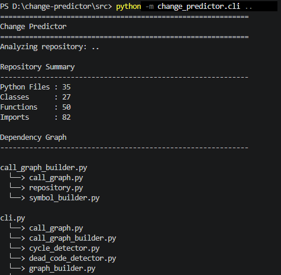
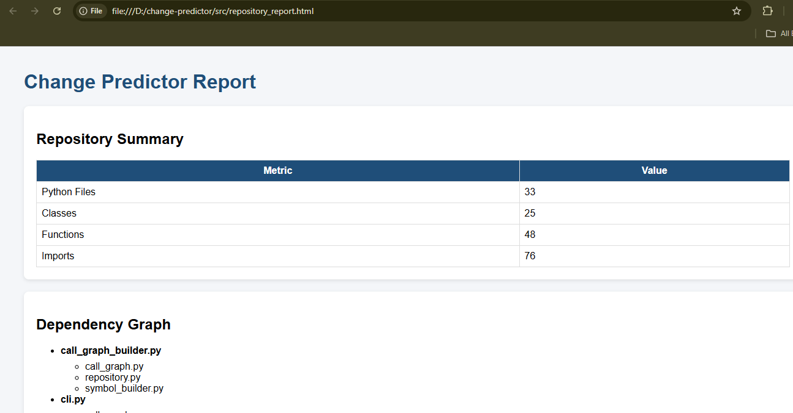
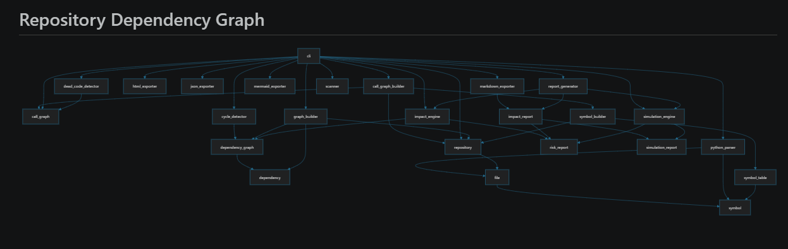
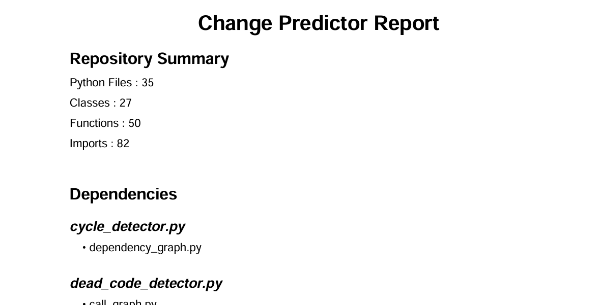

# Change Predictor

> Know what will break before you change your code.

> AI-powered engineering decision engine for software repositories.


Change Predictor is a Python-based static analysis tool that scans a repository, builds dependency and call graphs, detects circular dependencies and unused code, estimates change impact, simulates modifications, and generates professional reports in multiple formats.

---

## ✨ Features

- Repository Scanner
- AST-based Python Parser
- Dependency Graph Generation
- Function Call Graph
- Circular Dependency Detection
- Dead Code Detection
- Change Impact Analysis
- Change Simulation
- JSON Export
- HTML Report
- Markdown Report
- Mermaid Graph Export
- PDF Report

---

## 🏗️ Architecture

```
Repository
     │
Repository Scanner
     │
Python AST Parser
     │
 ┌───────────────┐
 │               │
Dependency Graph Symbol Table
 │               │
 │         Call Graph Builder
 │               │
 └──────┬────────┘
        │
 Analysis Engine
 ┌──────┼────────────┐
 │      │            │
Impact  Cycles   Dead Code
 │
Exporters
(JSON / HTML / Markdown /
 Mermaid / PDF)
```

---

## 📂 Project Structure

```
change_predictor/
│
├── analysis/
├── analyzer/
├── call_graph/
├── exporters/
├── graph/
├── impact/
├── models/
├── reporting/
├── simulation/
├── symbols/
└── cli.py
```

---

## 🚀 Installation

```bash
git clone https://github.com/yourusername/change-predictor.git

cd change-predictor

pip install -r requirements.txt
```

---

## ▶ Usage

Analyze repository

```bash
python -m change_predictor.cli path/to/repository
```

Impact Analysis

```bash
python -m change_predictor.cli path/to/repository --impact repository.py
```

Simulation

```bash
python -m change_predictor.cli path/to/repository --simulate repository.py
```

Generate JSON

```bash
python -m change_predictor.cli path/to/repository --json
```

Generate HTML

```bash
python -m change_predictor.cli path/to/repository --html
```

Generate Markdown

```bash
python -m change_predictor.cli path/to/repository --markdown
```

Generate Mermaid Graph

```bash
python -m change_predictor.cli path/to/repository --mermaid
```

Generate PDF

```bash
python -m change_predictor.cli path/to/repository --pdf
```

---

## 📊 Sample Output

Repository Summary

```
Python Files : 35
Classes      : 27
Functions    : 50
Imports      : 82
```

Impact Analysis

```
Target File : repository.py

Risk Level : HIGH
Risk Score : 60

Affected Files
---------------
call_graph_builder.py
cli.py
graph_builder.py
symbol_builder.py
```

---
## 📷 Screenshots

### CLI Analysis

Shows repository analysis, dependency graph, circular dependency detection, and dead code detection.



---

### HTML Report

Interactive HTML report generated by the tool.



---

### Dependency Graph

Mermaid visualization of module dependencies.



---

### PDF Report

Professional PDF summary of repository analysis.


---

## 📄 Reports Generated

- JSON
- HTML
- Markdown
- Mermaid Graph
- PDF

---

## 🛠️ Tech Stack

- Python
- AST
- ReportLab
- Mermaid
- HTML/CSS

---

## 📌 Future Improvements

- Graph Visualization UI
- Interactive Web Dashboard
- Git Diff Analysis
- CI/CD Integration
- VS Code Extension
- Multi-language Support
